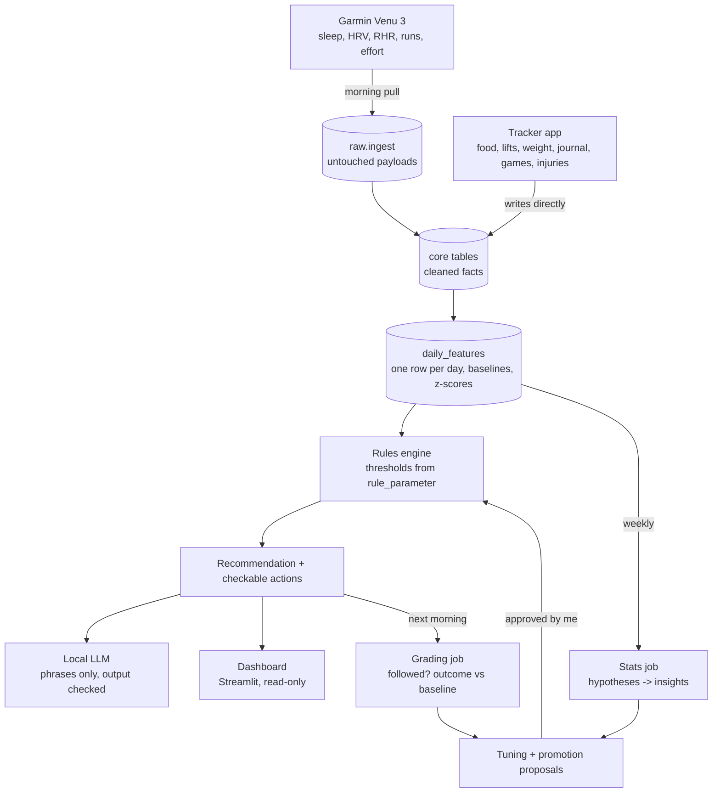

# Personal Health & Training System

A local system that collects my wearable, nutrition, training, and journal data, computes stats and
rule-based recommendations in code, and uses a local LLM **only to phrase them** as a short daily
coaching message. Everything runs on my own machine.

<p>
  
  
  
</p>

*Screenshots use the synthetic demo athlete; no real health data is in this repo.*

## How it works



**Principles:**

1. Code decides; the LLM phrases.
2. Everything is local.
3. Every load is an idempotent upsert.
4. Every recommendation records what it saw.
5. New rules run hidden (shadow mode) until my data supports them.
6. Recovery is judged against **my** rolling baseline.
7. Logging takes under two minutes a day.

| Part | What it is |
|---|---|
| `src/healthtracker/ingest`, `transform` | Garmin Connect pull (`garminconnect`), FIT fallback, raw -> core parsers, overlap merge (Garmin wins) |
| `features` | `daily_features` (load, ACWR, baselines over *eligible* days, pace at reference HR), weekly hard sets, e1RM |
| `rules` | 16 starter rules + experiment protocol; thresholds live in the DB so they can be tuned without code |
| `recommend` | Recommendation, structured actions, next-day grading (followed? outcome vs baseline) |
| `llm` | Ollama client, two small calls (training, nutrition), output guard, template fallback |
| `stats` | Weekly hypothesis tests (OLS + HAC errors, block bootstrap, BH correction, replication), tuning, rule promotion, self-experiments |
| `planning` | Next week's plan around fixed games, recovery state, and injury restrictions |
| `api` + `web/` | FastAPI + React installable phone app (barcode scanning via Open Food Facts) |
| `dashboard` | Streamlit + Plotly, read-only |

The schema is `db/migrations/001_schema_v3.sql` (raw / core / analytics / knowledge layers) plus
`002_app_support.sql`. Design decisions are in [docs/design-notes.md](docs/design-notes.md).

## Quick start

Needs Docker with the compose plugin, and [Ollama](https://ollama.com) with the model pulled:

```bash
ollama pull qwen3:14b              # ~9 GB; any model works, set LLM_MODEL in .env
cp .env.example .env               # then set POSTGRES_PASSWORD (and the URLs that contain it)
docker compose up -d               # db, migrations, api + app, dashboard, scheduler
```

- Tracker app: http://localhost:8000
- Dashboard: http://localhost:8501

**Try it with sample data first.** The demo builds a separate `healthtracker_demo` database with
180 days of a synthetic athlete, with real-looking Garmin payloads and planted effects, and never
touches your real data:

```bash
docker compose --profile demo up -d     # app on :8001, dashboard on :8502
```

## Connect Garmin

The Garmin password is never stored. Log in once; refresh tokens go to `./secrets/garmin`.

```bash
docker compose run --rm -it api healthtracker garmin-login      # asks for email, password, MFA code
docker compose run --rm api healthtracker garmin-backfill --days 120
docker compose run --rm api healthtracker backfill --start 2026-06-01
```

The scheduler then pulls every morning at 07:30 and 10:30, and runs the weekly loop on Sunday at
20:00 (`docker/crontab`). After syncing your watch you can also tap **Refresh** in the app.

If the unofficial API breaks, export activities as FIT from Garmin Connect, drop them in
`data/inbox/`, and run `docker compose run --rm api healthtracker import-fit /data/inbox`.

## Use it from your phone (Tailscale)

The services listen on localhost only. Tailscale makes them reachable from your devices, and only
from them, over HTTPS. The camera barcode scanner needs HTTPS.

```bash
sudo tailscale up
sudo tailscale serve --bg --https=443  http://127.0.0.1:8000    # tracker app
sudo tailscale serve --bg --https=8443 http://127.0.0.1:8501    # dashboard
```

Open `https://<machine>.<tailnet>.ts.net` on the phone and choose **Add to Home Screen**. In the
app, set *Settings → Dashboard address* to `https://<machine>.<tailnet>.ts.net:8443`.

## Daily routine (under two minutes)

- **Morning (Today tab):** five journal taps, then your weight. Read the coaching and rate it.
- **Meals (Food tab):** recent foods and saved meals take one tap; scan new barcodes. Tick
  *log complete* at the end of the day.
- **Games (Train tab):** minutes played and effort, since the watch is off during games.
- **Lifts (Train → Lift):** sets, reps, weight, and reps in reserve. "Last time" is prefilled.
- **Injuries (Body tab):** a daily pain check-in while an injury is active.

## Roadmap status

| Phase (plan) | Status |
|---|---|
| 1 Foundation: Postgres, Garmin ingestion, core tables, tracker app, `daily_features`, dashboard | Built |
| 2 Starter rules & coaching: recommendations, actions, grading, LLM phrasing | Built. Rules start in **shadow** mode; activate the fixed-target ones (protein, calories, post-game, short sleep) once a week of clean data exists |
| 3 Baselines, lifts, injuries | Built. Baseline rules stay dormant until `min_history_days` (about 21 days) |
| 4 Learning loop: weekly stats, insights, tuning with approval, self-experiments, shadow promotion | Built. First hypotheses need about 20 days per group |
| 5 Readiness model, clustering, change points, RAG | Not started (needs 6-12 months of data) |

## CLI

```
healthtracker init-db | migrate
healthtracker garmin-login | garmin-backfill --days N | import-fit PATH...
healthtracker nightly [--date D] [--skip-ingest] [--no-llm]
healthtracker weekly [--date D]
healthtracker backfill --start D [--end D] [--llm-days N]
healthtracker demo [--days 180] [--llm-days N]
healthtracker proposals list | approve param|status ID | reject ...
healthtracker rules list | set RULE_ID shadow|active|retired
healthtracker experiment HYPOTHESIS_ID [--start D] [--days 14]
healthtracker status
```

Inside Docker, prefix with `docker compose run --rm api`.

## Development

```bash
python3 -m venv .venv && .venv/bin/pip install -e '.[dev]'
docker compose up -d db
.venv/bin/healthtracker init-db && .venv/bin/healthtracker demo
.venv/bin/pytest                                  # DB tests use TEST_DATABASE_URL
.venv/bin/uvicorn healthtracker.api.main:app --reload
cd web && npm install && npm run dev               # :5173, proxies /api to :8000
.venv/bin/streamlit run src/healthtracker/dashboard/Today.py
```

## Privacy

Real data lives in the Postgres volume and `./secrets` and never leaves the machine. Two outbound
calls exist: Garmin Connect (your own account) and Open Food Facts (barcode lookups send only the
barcode number). `.env`, `secrets/`, and `data/` are git-ignored. This is not a medical device;
anything concerning goes to a doctor or physical therapist.
