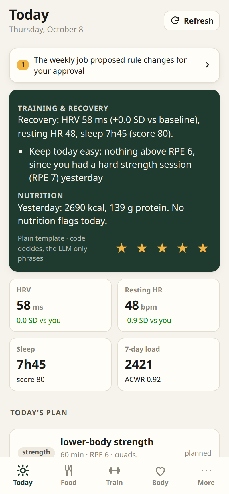
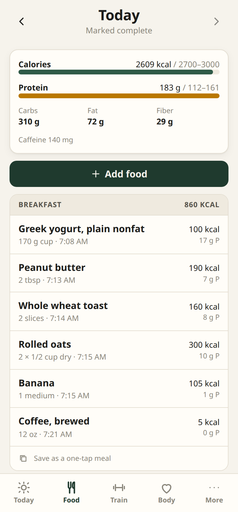
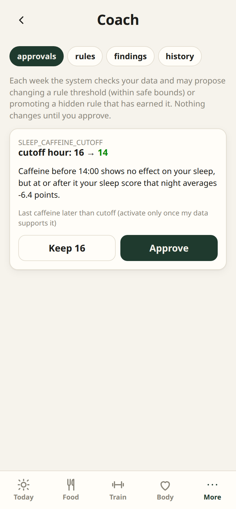
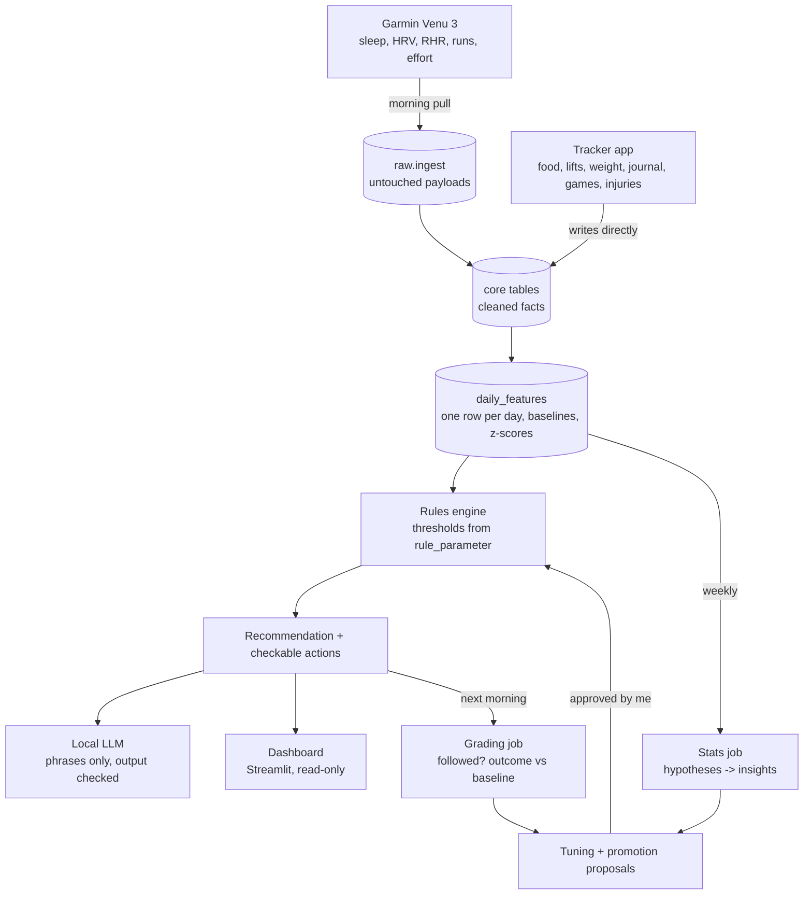

# Personal Health & Training System

A local system that collects my wearable, nutrition, training, and journal data, computes stats and
rule-based recommendations in code, and uses a local LLM **only to phrase them** as a short daily
coaching message. Everything runs on my own machine.

<p>
  
  
  
</p>

*Screenshots use the synthetic demo athlete; no real health data is in this repo.*

## How it works



**Principles:**

1. Code decides; the LLM phrases.
2. Everything is local.
3. Every load is an idempotent upsert.
4. Every recommendation records what it saw.
5. New rules run hidden (shadow mode) until my data supports them.
6. Recovery is judged against **my** rolling baseline.
7. Logging takes under two minutes a day.

| Part | What it is |
|---|---|
| `src/healthtracker/ingest`, `transform` | Garmin Connect pull (`garminconnect`), FIT fallback, raw -> core parsers, overlap merge (Garmin wins) |
| `features` | `daily_features` (load, ACWR, baselines over *eligible* days, pace at reference HR), weekly hard sets, e1RM |
| `rules` | 16 starter rules + experiment protocol; thresholds live in the DB so they can be tuned without code |
| `recommend` | Recommendation, structured actions, next-day grading (followed? outcome vs baseline) |
| `llm` | Ollama client, two small calls (training, nutrition), output guard, template fallback |
| `stats` | Weekly hypothesis tests (OLS + HAC errors, block bootstrap, BH correction, replication), tuning, rule promotion, self-experiments |
| `planning` | Next week's plan around fixed games, recovery state, and injury restrictions |
| `goals` | Weight goals that set calorie/protein targets from my own energy balance; performance, health, and habit goals tracked from `daily_features` |
| `api` + `web/` | FastAPI + React installable phone app: food (barcode scanning via Open Food Facts), water, lifts, games, weight, journal, injuries, goals |
| `dashboard` | Streamlit + Plotly, read-only; styled like the app and usable on a phone |

The schema is `db/migrations/001_schema_v3.sql` (raw / core / analytics / knowledge layers) plus
`002_app_support.sql` and the later numbered migrations (`005_goals.sql` adds goals, `006_water.sql`
water intake). Migrations run automatically on `docker compose up`. Design decisions are in
[docs/design-notes.md](docs/design-notes.md).

## Quick start

Needs Docker with the compose plugin, and [Ollama](https://ollama.com) with the model pulled:

```bash
ollama pull qwen3:14b              # ~9 GB; any model works, set LLM_MODEL in .env
cp .env.example .env               # then set POSTGRES_PASSWORD (and the URLs that contain it)
docker compose up -d               # db, migrations, api + app, dashboard, scheduler
```

- Tracker app: http://localhost:8000
- Dashboard: http://localhost:8501

**Try it with sample data first.** The demo builds a separate `healthtracker_demo` database with
180 days of a synthetic athlete, with real-looking Garmin payloads and planted effects, and never
touches your real data:

```bash
docker compose --profile demo up -d     # app on :8001, dashboard on :8502
```

## Connect Garmin

The Garmin password is never stored. Log in once; refresh tokens go to `./secrets/garmin`.

```bash
docker compose run --rm -it api healthtracker garmin-login      # asks for email, password, MFA code
docker compose run --rm api healthtracker nightly               # test it: ingest_garmin should be ok
docker compose run --rm api healthtracker garmin-backfill --days 120   # only if the watch has history
docker compose run --rm api healthtracker backfill --start 2026-06-01
```

During login, `429 ... rate limited` warnings are normal; the client falls back to another login
method. It worked if it ends with `Tokens saved`. Tokens last months; if `healthtracker status` shows
`ingest_garmin failed`, log in again. A long backfill can also hit a 429; wait an hour and rerun it
(it skips what it already has).

The scheduler pulls at 04:00, 07:30, and 10:30, and runs the weekly loop on Sunday at 20:00, all in
the `TZ` from `.env` (`docker/crontab`). The 04:00 run picks up yesterday's workouts and logs; last
night's sleep and HRV only exist after the watch syncs in the morning, so the later runs fill them
in (every run is an upsert). After syncing your watch you can also tap **Refresh** in the app.

On the phone, Garmin Connect only needs to be installed and signed in; it syncs the watch in the
background. On Android, set it to **Unrestricted** battery use (Settings → Apps → Garmin Connect →
Battery) so the phone doesn't put it to sleep. Opening it for a few seconds forces a sync.

If the unofficial API breaks, export activities as FIT from Garmin Connect, drop them in
`data/inbox/`, and run `docker compose run --rm api healthtracker import-fit /data/inbox`.

## Use it from your phone (Tailscale)

The services listen on localhost only. Tailscale makes them reachable from your devices, and only
from them, over HTTPS. The camera barcode scanner needs HTTPS.

```bash
curl -fsSL https://tailscale.com/install.sh | sh      # or: sudo apt-get install -y tailscale
sudo tailscale up                                     # opens a login link
sudo tailscale serve --bg --https=443  http://127.0.0.1:8000    # tracker app
sudo tailscale serve --bg --https=8443 http://127.0.0.1:8501    # dashboard
tailscale serve status
```

`serve` needs HTTPS certificates turned on for the tailnet: in the admin console under **DNS**,
enable MagicDNS and **HTTPS Certificates**. The serve config survives reboots. If the install
script stops at `apt-get update` because some *other* repository is broken, the Tailscale repo is
already added; just run `sudo apt-get install -y tailscale`.

On the phone, install the Tailscale app and sign in with the same account (turn on *Start on boot*,
and on Android optionally *Always-on VPN*), then open `https://<machine>.<tailnet>.ts.net`:

- **Android (Chrome):** menu ⋮ → **Install app** (or **Add to Home screen** → Install). It opens
  full screen from its own icon and shows up in the app drawer.
- **iPhone (Safari):** Share → **Add to Home Screen**.

In the app, set *Settings → Dashboard address* to `https://<machine>.<tailnet>.ts.net:8443`.
Logging needs the computer running (your data stays on it); with it off, the app still shows what
it last loaded.

**Updates** reach the phone without GitHub: rebuild on the computer (`docker compose up -d --build`)
and the installed app picks up the new version the next time it is opened or brought to the front.
Android does not refresh an installed app's home-screen **icon**; uninstall and reinstall the app to
get a new one (your data is on the computer, so nothing is lost).

## Dashboard

The dashboard (`:8501`, or `:8443` through Tailscale, or *More → Dashboard* in the app) is the
in-depth view of everything: recovery trends against your baseline, training load, nutrition
(calories, protein per kg, macros, water, weekly micronutrients against targets, meal and caffeine
timing), injuries, insights, coaching history, and pipeline health. It is read-only and dark, in the
app's colors and fonts (served locally from `src/healthtracker/dashboard/static`), and works on a
phone. Charts need data: recovery baselines take about 30 days of wear.

Micronutrients: every food records calories, protein, carbs, fat, fiber, sugar, sodium, caffeine,
and alcohol. Foods scanned by barcode also store iron, magnesium, calcium, potassium, zinc, and
vitamin D when Open Food Facts lists them. Foods without micronutrient data count as zero in the
weekly view, so a low number can be a data gap.

## Daily routine (under two minutes)

- **Morning (Today tab):** five journal taps, then your weight. Read the coaching and rate it.
- **Water (Today or Food tab):** one tap per glass or bottle; *Other* for any amount. The daily goal
  is about 35 ml per kg of body weight.
- **Meals (Food tab):** recent foods and saved meals take one tap; scan new barcodes. Tick
  *log complete* at the end of the day.
- **Games (Train tab):** minutes played and effort, since the watch is off during games.
- **Lifts (Train → Lift):** sets, reps, weight, and reps in reserve. "Last time" is prefilled.
- **Injuries (Body tab):** a daily pain check-in while an injury is active.
- **Goals (More → Goals):** set once. A weight goal (lose, gain, or maintain, at a chosen pace)
  sets your calorie and protein targets; the weekly job re-estimates what you burn from your own
  logs and proposes target changes for you to approve. Performance (5K, lift 1RM, pace at
  reference HR, VO2 max), health (resting HR, HRV), and habit goals (sleep, protein, complete food
  log, training days, alcohol) track themselves.

## Running it day to day

Nothing has to stay open on the computer. Docker, Tailscale, and Ollama start at boot (no login
needed) and every service has `restart: unless-stopped`, so a reboot brings everything back. The
computer only has to be on and awake: if it is off for a scheduled pull, that run is skipped (the
next one, or **Refresh**, catches up). Set the BIOS to *Restore on AC Power Loss → Power On* so it
comes back after a power cut.

From the project folder:

| Task | Command |
|---|---|
| What's running | `docker compose ps` |
| Live logs | `docker compose logs -f api` (or `dashboard`, `scheduler`) |
| Did the jobs run | `docker compose run --rm api healthtracker status` |
| Restart everything | `docker compose restart` |
| Deploy code changes | `docker compose up -d --build` |
| Stop / start | `docker compose stop` / `docker compose up -d` |

Avoid `docker compose down` for everyday use: it removes the containers, and they won't come back
at boot until the next `docker compose up -d`.

**Backups.** All data is in the `pgdata` Docker volume. Take a snapshot before risky changes (and,
once there is a second drive or another machine, on a schedule, kept off this disk):

```bash
mkdir -p data/backups
docker compose exec -T db sh -c 'pg_dump -U "$POSTGRES_USER" -d healthtracker -Fc' \
  > data/backups/healthtracker-$(date +%F).dump
# restore (replaces what is in the database now):
docker compose exec -T db sh -c 'pg_restore -U "$POSTGRES_USER" -d healthtracker --clean --if-exists' \
  < data/backups/healthtracker-YYYY-MM-DD.dump
```

`data/` is git-ignored, so backups never go to GitHub.

## Roadmap status

| Phase (plan) | Status |
|---|---|
| 1 Foundation: Postgres, Garmin ingestion, core tables, tracker app, `daily_features`, dashboard | Built |
| 2 Starter rules & coaching: recommendations, actions, grading, LLM phrasing | Built. Rules start in **shadow** mode; activate the fixed-target ones (protein, calories, post-game, short sleep) once a week of clean data exists |
| 3 Baselines, lifts, injuries | Built. Baseline rules stay dormant until `min_history_days` (about 21 days) |
| 4 Learning loop: weekly stats, insights, tuning with approval, self-experiments, shadow promotion | Built. First hypotheses need about 20 days per group |
| 5 Readiness model, clustering, change points, RAG | Not started (needs 6-12 months of data) |

## CLI

```
healthtracker init-db | migrate
healthtracker garmin-login | garmin-backfill --days N | import-fit PATH...
healthtracker nightly [--date D] [--skip-ingest] [--no-llm]
healthtracker weekly [--date D]
healthtracker backfill --start D [--end D] [--llm-days N]
healthtracker demo [--days 180] [--llm-days N]
healthtracker proposals list | approve param|status ID | reject ...
healthtracker rules list | set RULE_ID shadow|active|retired
healthtracker experiment HYPOTHESIS_ID [--start D] [--days 14]
healthtracker status
```

Inside Docker, prefix with `docker compose run --rm api`.

## Development

```bash
python3 -m venv .venv && .venv/bin/pip install -e '.[dev]'
docker compose up -d db
.venv/bin/healthtracker init-db && .venv/bin/healthtracker demo
.venv/bin/pytest                                  # DB tests use TEST_DATABASE_URL
.venv/bin/uvicorn healthtracker.api.main:app --reload
cd web && npm install && npm run dev               # :5173, proxies /api to :8000
cd web && npm run demo                             # no backend: mock data; phone preview at :5173/demo.html
cd web && npx tsc -b                               # typecheck the app
.venv/bin/streamlit run src/healthtracker/dashboard/Today.py
```

## Privacy

Real data lives in the Postgres volume and `./secrets` and never leaves the machine. Two outbound
calls exist: Garmin Connect (your own account) and Open Food Facts (barcode lookups send only the
barcode number). `.env`, `secrets/`, and `data/` are git-ignored. This is not a medical device;
anything concerning goes to a doctor or physical therapist.
